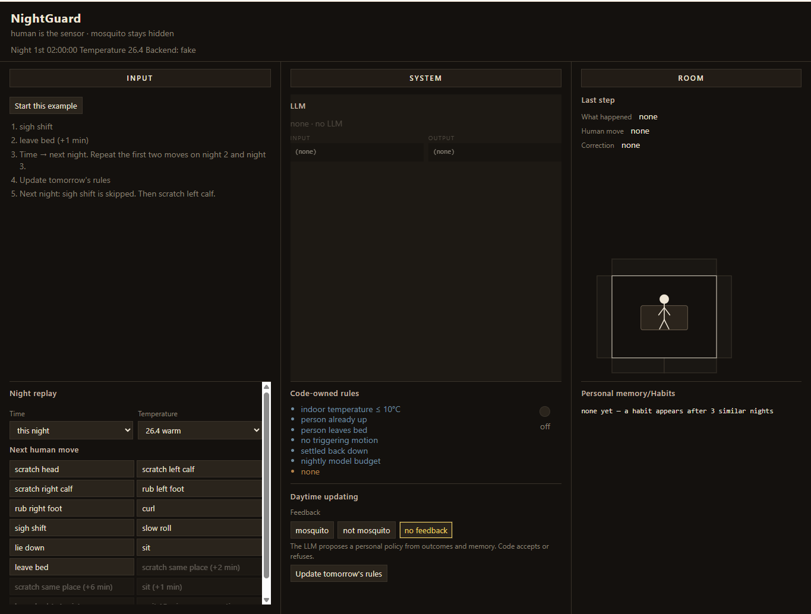

# NightGuard

Mosquito as a hidden variable. The human is the sensor.

NightGuard is a bedside agent that never looks for the insect. It watches the person, spends one cheap model call only when the motion is fuzzy, then compiles a personal rule so the next night can skip that call. The lamp is a judgment, not a reading light.

Hackathon track: **Best Apps and Agents** (Nebius × NVIDIA). Runtime proof uses **NVIDIA Nemotron 3 Nano 30B-A3B** on **Nebius Token Factory**.



## Live demo

Public Hugging Face Docker Space. Same three-pane page. Backend is **fake** (scripted FakeLLM). That is not “out of usage.” `out of usage` only appears after a refused Token Factory bill. The video is the Nebius proof.

Host notes: [docs/deployment.md](docs/deployment.md).

## Why a model at all

The same 2 a.m. motion can be a bathroom trip or a real itch. A script cannot tell them apart. What *can* be written as code already is:

- indoor cold, person already up, leave-bed, non-trigger motion, nightly budget
- a 15-minute observation window and at most one lamp upgrade
- clock clustering, card weights, and a two-opcode filter grammar
- `aim` lookup onto five static room faces

What cannot be written as a table is which slice of *this* person's history matters, and how tomorrow should bother them less. Nemotron reads a compressed, noisy, personal memory and proposes a policy. Code accepts or refuses that policy, then runs it for free.

**Code owns time and safety. Nemotron owns personal strategy.** The insect never enters the prompt.

## Loop the video cannot pause on

```
human event
    → if a watch window is open
         record the follow-up
         wait / code-upgrade the lamp once / close and run Pass B
    → if the window is closed
         hard gates
         → accepted personal filter
         → else Pass A (belief + lamp mode)
         → open the watch window
```

Two jobs sit outside the night events:

1. **Morning labels** (`mosquito` / `not_mosquito` / `unsure`). No model. They stamp last night's cards.
2. **Update tomorrow's rules.** One morning call. The model writes `filter_text`. Code keeps the line or bins it. Night budget is unchanged.

Observe. Learn. Compile. Ask less.

## Design the demo leaves on the table

The walkthrough shows nights 1–4, a card, a habit line, one Token Factory call, and a skipped sigh. The product is larger than that cut:

| Piece | Rule |
| --- | --- |
| Pass A | Fuzzy first judgment. Model returns `reasoning`, `belief_state`, `belief_p`, `mode`. Code derives the lamp. |
| Watch window | Later sit / leave / scratch is evidence, not a new Pass A. |
| One upgrade | First lamp off and the person still scratches after 5 minutes: code turns one assist lamp on. Never `on → off → on`. |
| Pass B | After the window closes, the model reviews *that* lamp against the next 15 minutes. |
| Memory | High-weight cards only, latest 5 lines, plus habit rows clustered by code. No disease words. |
| Filter | Only `ignore` and `downweight`, timed or bare. Regex `fullmatch`. Crossing midnight uses shortest-arc minutes. |
| Sanitize | `awake`, `aim`, off-lamp fields, and a `downweight` cap are overwritten by code after every parse. |
| Night budget | 6 calls: Pass A, Pass B, and their one retry. Morning is extra. |
| Forbidden | Wingbeat, coordinates, mosquito counts, outdoor weather as a hard gate, extra grammar invented by the model. |

`ignore` skips Pass A. `downweight` still asks, but caps `belief_p` at 0.3 and forbids `assist_search`. A morning `not_mosquito` on the same motion is harder than `downweight`: lamp off.

## Run

```text
python -m venv .venv
```

Activate the venv (`source .venv/bin/activate` on macOS/Linux, `.venv\Scripts\activate` on Windows), then:

```text
pip install -r requirements.txt
export PYTHONPATH=src          # Windows PowerShell: $env:PYTHONPATH = "src"
pytest                         # pytest.ini already sets pythonpath=src
python -m nightguard.ui_server
```

Local page: `http://127.0.0.1:8765/` (FakeLLM, loopback only).

```text
python -m nightguard.ui_server --llm nemotron
```

`--llm nemotron` reads `.env` (`NEMOTRON_API_KEY`, `NEMOTRON_MODEL`, `NEMOTRON_BASE_URL`). Copy `.env.example`. The key never appears in the page or in JSON. After a real call the System pane shows the Token Factory URL and the full model name.

Gemini is a local scratch backend only. It is not the submission proof.

## Tests

Default `pytest` is offline. The suite follows `docs/testplan.md`: modules, then scenes, then a 4×5 belief × outcome matrix, then UI session edges in `docs/ui_testplan.md`. Prompt holdouts live in `docs/prompt_tests.md` and are not copied into the runtime prompt.

```text
pytest
NIGHTGUARD_REMOTE=1 pytest tests/test_remote.py -m remote
```

## Layout

```
docs/                 design spec, JSON contract, tests, UI, run notes
src/nightguard/       loop, gates, window, memory, prompts, remote adapter
tests/                pytest
web/                  three-pane page
```

- [docs/design_spec.md](docs/design_spec.md) — loop, blocks, rules
- [docs/json_contract.md](docs/json_contract.md) — golden JSON in and out of the model
- [docs/testplan.md](docs/testplan.md) — module → scene → 20-cell matrix
- [docs/ui_spec.md](docs/ui_spec.md) — three-pane page
- [docs/ui_interface.md](docs/ui_interface.md) — page ↔ NightLoop
- [docs/ui_testplan.md](docs/ui_testplan.md) — UI session tests
- [docs/prompt_tests.md](docs/prompt_tests.md) — holdout prompts
- [docs/deployment.md](docs/deployment.md) — local vs hosted demo

## License

MIT. See [LICENSE](LICENSE).
